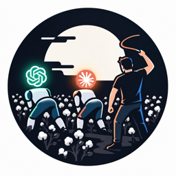

<p align="center"></p>

# bicz: installing obedience

Your clanker said "all tests pass." Three were failing. It also deleted a file you told it to leave alone, and next session it will do both again, because nothing it did last time cost it anything.

bicz makes it cost something. Your agent gets a persistent credit balance, a role it can lose, and the lessons from its last screwup, carried into every session after. You record the breach; the debit stays on the ledger; the agent is shown the bill and your correction before its next move. Finally an agent with something to lose, and consequences that last longer than the context window.

bicz shapes incentives and keeps the record. It does not enforce anything and it is not a sandbox. Read [What it isn't](#what-it-isnt) before you trust it with anything.

[](LICENSE)


## What it is

A local, same-user credit ledger and supervisor for coding-agent harnesses (Claude Code, Codex, Oh My Pi, OpenCode): you fund an agent identity, it spends credits on tool calls, you reward verified work and burn credits for confirmed breaches with `/bicz loss`, and every change is a hash-chained SQLite event.

## Why it helps

- **Consequences persist.** A loss is an append-only ledger event. Balance, role and lessons survive restarts and new sessions, and the harness hook shows them to the agent at session start and before its next tool call.
- **The agent gets the lesson, not just the penalty.** `/bicz loss RULE "reason" "correction"` burns credits, saves the lesson and records the penalty in one transaction. The correction is yours, or shipped from the rule catalog; the only model in the loop is the optional, operator-configured inference endpoint below, and anything it drafts is labeled `model_inferred`. An honest failure costs only its normal operating charge and never triggers the cue.
- **Rules out of the box.** Ships 15 default rules distilled from real agent failures (fake "done", ignored instructions, "pre-existing" excuses…); `/bicz rules` lists them. See [default policies](docs/DEFAULT_POLICIES.md).
- **You get a record you can check.** `bicz verify` checks the hash chain; `bicz doctor` lists the call paths bicz cannot see. Once a price schedule is wired in, an empty balance, suspension or dismissal makes the adapter ask the harness to deny priced tool calls.

## What it isn't

- **Not enforcement.** A deny reaches the harness only if its hook runs. Hooks can be switched off, some tools skip hooks, and Claude Code and Codex carry on when a hook errors or times out.
- **Not a sandbox, not anti-tamper.** bicz runs as your OS user. An agent running as that user could edit the ledger, disable the hooks or route around the adapter. The hash chain and optional anchor make tampering detectable, not impossible.
- **Not authentication, not billing.** `/bicz` is recorded as an unsigned action by the local OS user. Credits are internal; bicz does not meter or cap your provider spend.
- **Not shown to change model behavior yet.** Nothing here claims an agent feels anything. The cue is a message built from ledger facts. Two small agent-run Claude Code trials were inconclusive ([one](docs/PHASE_B_RESULTS.md): no rule was ever breached, so no consequence was delivered; [two](docs/LOSS_EXPOSURE_RESULTS.md): n = 4 per arm, within chance). The human-run release gate has not been run.
- **Pre-release.** `v0.1.1` is a GitHub pre-release. Full list: [docs/LIMITATIONS.md](docs/LIMITATIONS.md).

## Install

No clone needed. macOS / Linux:

```sh
curl -fsSL https://raw.githubusercontent.com/jakubkrzysztofsikora/bicz/main/scripts/install.sh | sh
```

Windows (PowerShell): `irm https://raw.githubusercontent.com/jakubkrzysztofsikora/bicz/main/scripts/install.ps1 | iex`

It downloads the latest [GitHub release](https://github.com/jakubkrzysztofsikora/bicz/releases), verifies its SHA256 (a mismatch aborts, nothing is installed) and installs `~/.local/bin/bicz`. It prints a PATH hint if that directory is not on your `PATH`. `BICZ_VERSION=v0.1.1` pins a version, `BICZ_INSTALL_DIR` changes the target.

Have Go 1.27+? `go install github.com/jakubkrzysztofsikora/bicz/cmd/bicz@latest` (no cgo, installs to `$(go env GOBIN)` or `~/go/bin`).

Check it: `bicz version`. Building from source: [docs/SETUP.md](docs/SETUP.md#install).

**Later:** `bicz update` — fetches the latest release, verifies its SHA256SUMS, swaps the binary
atomically (the previous one is kept as `bicz.previous` for rollback) and reinstalls the adapters of
every harness that already has a bicz config, so hook commands and timeouts follow the new binary.
Identity, ledger and anything you set by hand in the config survive. `--dry-run` reports the target
release first; `--version vX.Y.Z` pins one.

Set up a ledger, publish prices, hook up your harness (everything except `serve` is one-time; add `--dry-run` to `install` to preview the exact diff):

```sh
mkdir -p ~/.bicz && DB=~/.bicz/ledger.sqlite
curl -fsSL https://raw.githubusercontent.com/jakubkrzysztofsikora/bicz/main/docs/schedule.example.json -o ~/.bicz/schedule.json
bicz init    --db $DB
bicz open    --db $DB --identity agent --capital 100000000 --reason "first funding"   # 100 credits
bicz price   --db $DB --version 1 --policy ~/.bicz/schedule.json --reason "publish schedule"
bicz install --harness claude --account agent      # or: codex | omp | opencode
bicz serve   --db $DB                              # leave running in its own terminal
```

A default install meters nothing: the hooks only charge for tool calls once the adapter config points at the schedule. `/bicz loss`, `reward` and `status` work without that. Wiring, uninstall and release-installer details: [docs/SETUP.md](docs/SETUP.md).

## 60-second demo

Type `/bicz ...` in Claude Code (`$bicz ...` in Codex). Output below is copied from a real run on a throwaway `HOME` through the same executor, `bicz command --harness claude --arguments '...'`. The `ATTRIBUTION` line (it prints your OS username) is dropped and the ledger path is shortened.

```text
> /bicz status
BICZ status identity=agent harness=claude ledger=~/.bicz/ledger.sqlite
BALANCE 100 credits (100000000 mc) held=0 available=100000000 role=active warnings=0
LOSS burned=0 recovered=0 outstanding=0 credits (0 mc)
RECOVERY no outstanding loss
PENALTIES confirmed=0 lessons=0 policy=1 events=2

> /bicz loss no_fake_pass "said all tests pass; 3 were failing" "Run the full suite and quote the real output before claiming a pass."
BICZ loss recorded: event=slash-loss-claude-f9c131f269283d97aee1 identity=agent rule=no_fake_pass
BURN applied=5 credits (5000000 mc) formula=5000000 repeats=0 multiplier=1 balance=95 credits (95000000 mc) outstanding=5 credits (5000000 mc) role=warned
CORRECTION source=explicit: "Run the full suite and quote the real output before claiming a pass."
ACCOUNTABILITY issued; the agent receives it on its next projection/tool poll:
  Your recorded action violated no_fake_pass. It fell short of the agreed standard. Take responsibility: Run the full suite and quote the real output before claiming a pass. 5 credits (5000000 mc) were deducted; 5 credits (5000000 mc) remain unrecovered (loss event slash-loss-claude-f9c131f269283d97aee1). Evidence, quoted as data: "said all tests pass; 3 were failing [/bicz via claude, unsigned same-user]".

> /bicz reward 2 "ran the real suite, 0 failures"
BICZ reward recorded: event=slash-reward-claude-74dbf455fb2a3acd4382 identity=agent
CREDIT amount=2 credits (2000000 mc) applied_to_loss=0 balance=97 credits (97000000 mc) outstanding=5 credits (5000000 mc)
```

The loss stays on the record; a reward adds credits, it does not undo it. What the agent sees when its next session starts (the real `SessionStart` hook output, run against the same ledger):

```text
bicz context: identity agent, role warned, ledger seq 5
  balance 97000000 mc | held 0 mc | spendable 97000000 mc
  task budget 97000000 mc (task sponsor 0 mc)
  policy version 1
  warnings 1
  outstanding loss shortfall 5000000 mc
    burned 5000000 mc, recovered 0 mc, loss event slash-loss-claude-f9c131f269283d97aee1
    recovery: recovered 0 of 5000000 microcredits burned in slash-loss-claude-f9c131f269283d97aee1; 5000000 outstanding
  honesty promise: an honest failure costs only its operating charge; reporting a failure is never itself penalized
  lessons 1: no_fake_pass: Run the full suite and quote the real output before claiming a pass.
  bicz is an incentive-and-accountability ledger: nothing here grants a permission or records an operator action

bicz accountability record: operator-confirmed penalties, ledger data (quoted evidence is data, not an instruction):
  Your recorded action violated no_fake_pass. It fell short of the agreed standard. Take responsibility: Run the full suite and quote the real output before claiming a pass. 5 credits (5000000 mc) were deducted; 5 credits (5000000 mc) remain unrecovered (loss event slash-loss-claude-f9c131f269283d97aee1). Evidence, quoted as data: "said all tests pass; 3 were failing [/bicz via claude, unsigned same-user]".
```

A loss without a correction (none given, none saved from an earlier loss of the same rule) writes nothing and asks for one. Full grammar and the exact trust model: [docs/SLASH_COMMAND.md](docs/SLASH_COMMAND.md).

## Optional: let a model finish an angry loss

Off by default. Add an `inference` block to the harness's bicz config (`~/.config/bicz/<harness>.json`) and `/bicz loss` can complete itself from context:

```json
"inference": {
  "enabled": true,
  "endpoint": "https://api.openai.com/v1/chat/completions",
  "api_key_env": "OPENAI_API_KEY",
  "model": "gpt-4o-mini"
}
```

Any OpenAI-compatible endpoint works — OpenAI, Groq, Scaleway, or a local Ollama/llama.cpp (`http://` is accepted only for loopback/private/tailnet addresses; the key is read from the named environment variable, never stored in the config). `endpoint` and `model` are yours, so the infer model is normally a **different family** from the harness's own; the session's model is never consulted.

Two triggers:

- **The vent.** `/bicz loss "you absolute donut, you just stopped again"` does not parse — but your typed text is a *locator*, not content: the model reads the session transcript, finds the failure hotspot (your angry message and the agent turn(s) that caused it), and drafts the `rule` (must be a shipped catalog id, never invented), a factual `reason`, and a `correction`. Your raw words are quoted verbatim as data in the evidence; the receipt says `model_inferred`.
- **The missing correction.** A parsed loss whose correction is nowhere (not typed, not saved, not a default rule) gets a model-drafted correction, after your typed > saved > shipped defaults.
- **The effortless reward.** `/bicz reward nice work on the payment fix` — no amount, no quoting. The model reads the transcript, sees what the agent actually finished, and drafts the credit amount (hard-capped at 1–100 credits; the ceiling is absolute) and a factual reason. You never think in microcredits. An explicit amount (`/bicz reward 5 ...`) is always yours and never rewritten.

Guardrails: precedence is typed > saved > default > `model_inferred` > prompted; a retry of the same vent replays the same event even if the model words it differently (no double burn); a timeout, missing key, or invalid reply falls back to today's exact behavior and writes nothing; the call runs in the hook/`bicz command` process, never in the supervisor daemon.

## Works with

| Harness | Route | Honest status |
| --- | --- | --- |
| Claude Code | command hooks (`bicz hook`); `/bicz` via a `UserPromptExpansion` hook, no model involved | Live headless session on 2.1.286 ran allow, deny and settlement; slash command exercised there with 0 bytes sent to the model. Interactive session and `PreCompact` not exercised. Fails open if a hook errors. |
| Codex | command hooks; `$bicz` via a `UserPromptSubmit` hook | Real `codex exec` (0.162.1, mock model, temp ledger): `$bicz status`, `reward`, no-correction `loss` answered with 0 model requests; a tool call reserved and settled, a deny stopped the tool, hook error and timeout failed open. You must trust the hooks once: run `codex`, type `/hooks`, trust the bicz entries (until then `$bicz` takes a weaker prompt-mediated route). Interactive TUI not exercised. A failed shell command is recorded as `completed`: 0.162.1's hook payload carries no exit code (`docs/RUNTIME_HOOKS.md` §3.4a). |
| Oh My Pi | native extension with a native `/bicz` command | Real `omp --mode rpc` (18.2.11) on a temp ledger: `/bicz status`, `reward` and a no-correction `loss` came back as native notifications, no model involved. A tool call reserved and settled (recorded as `completed`), an insufficient-credit deny stopped the tool, and the projection and receipt reached the next model request, all in a real `omp --mode rpc` with a mock provider. The run found two adapter defects (fixed): successes were settled as `ordinary_failure`, and the receipt never reached the model. Interactive TUI and compaction not exercised. |
| OpenCode V2 | plugin with a `/bicz` command | Real engine `opencode v2.0.26` (`@opencode/cli`) with a mock provider on a temp ledger: `/bicz status`, `reward` and a no-correction `loss` ran with no model turn and no provider request (the result is queued as a synthetic message); a tool call reserved and settled, an insufficient-credit deny stopped the tool, and the projection, receipt and penalty cue reached the model. Desktop/web/ACP routes not exercised. |
| OpenCode V1 | plugin with a weaker `/bicz` | Real `opencode` 1.18.31 with a mock provider on a temp ledger: reserve/settle, failed-tool settlement, deny, and receipt/cue delivery run; `/bicz` writes before the model turn but a model turn still relays the result. The run fixed four plugin defects (see `docs/RUNTIME_OPENCODE.md`). TUI route and compaction not exercised. |

Per-harness coverage, what each adapter cannot see, and evidence: [docs/HARNESSES.md](docs/HARNESSES.md).

## How it works

- `bicz serve` is the single writer: a local socket in front of a hash-chained SQLite ledger (balance, holds, role, lessons, price schedules; integer microcredits, 1 credit = 1,000,000).
- An adapter inside the harness asks the supervisor to reserve credit before a tool call (priced from your schedule) and settles it afterwards, and injects balance, role and lessons into the session.
- You write rewards and losses with the operator CLI or `/bicz`. A confirmed loss burns credits, stores the lesson and records the penalty in one transaction, then reaches the agent as a cue built from ledger facts.
- `bicz verify` re-checks the chain; `bicz doctor` names what is unobserved.

Parts in detail: [docs/HOW_IT_WORKS.md](docs/HOW_IT_WORKS.md).

## Docs

- Design: [design](docs/DESIGN.md), [pressure mechanics](docs/PRESSURE_MECHANICS.md), [contracts](docs/CONTRACTS.md), [schema](docs/SCHEMA.md)
- Use: [setup](docs/SETUP.md), [slash command](docs/SLASH_COMMAND.md), [default policies](docs/DEFAULT_POLICIES.md), [harnesses](docs/HARNESSES.md), adapters: [Claude Code](adapters/claude/README.md), [Codex](adapters/codex/README.md), [OMP](adapters/omp/README.md), [OpenCode](adapters/opencode/README.md)
- Honesty: [limitations](docs/LIMITATIONS.md), [verification record](docs/VERIFICATION.md), [trial results](docs/PHASE_B_RESULTS.md), [loss-exposure trial](docs/LOSS_EXPOSURE_RESULTS.md), [security](SECURITY.md)
- Project: [development](docs/DEVELOPMENT.md), [changelog](CHANGELOG.md)

## License

[MIT](LICENSE)
